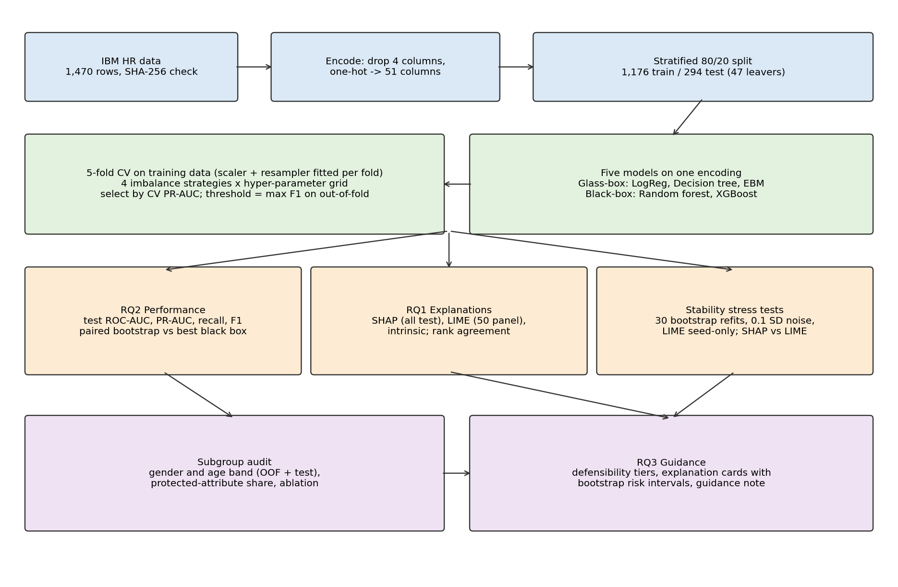
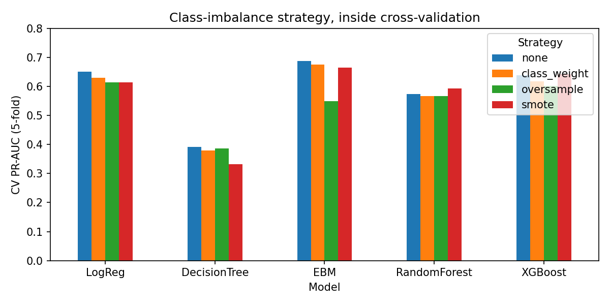
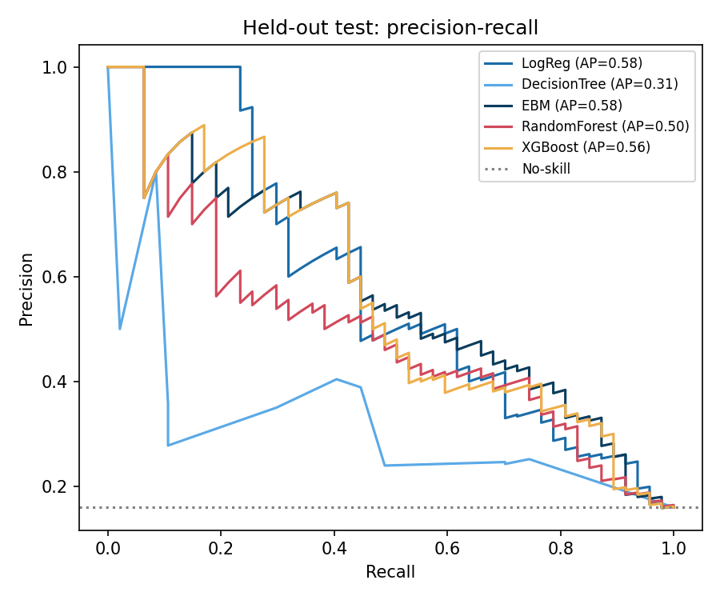
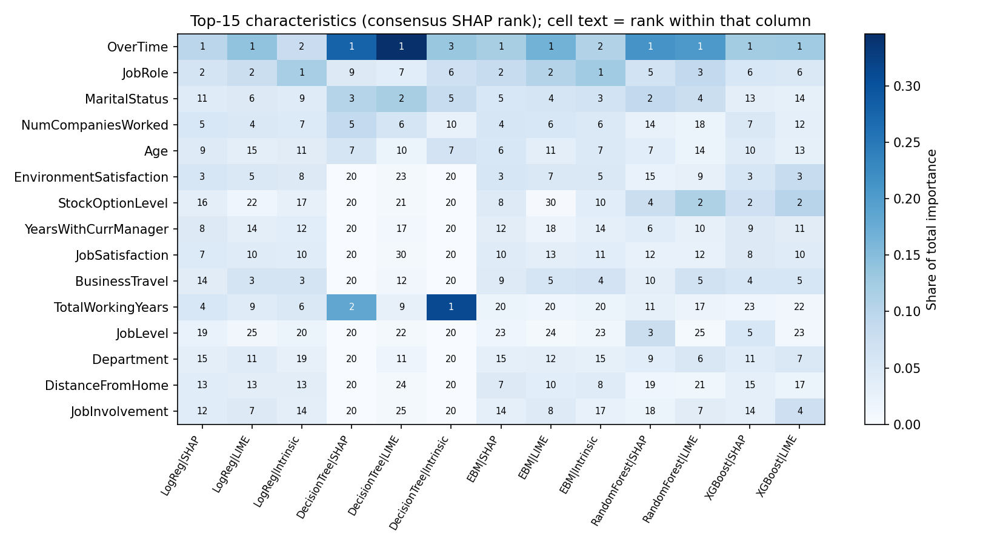
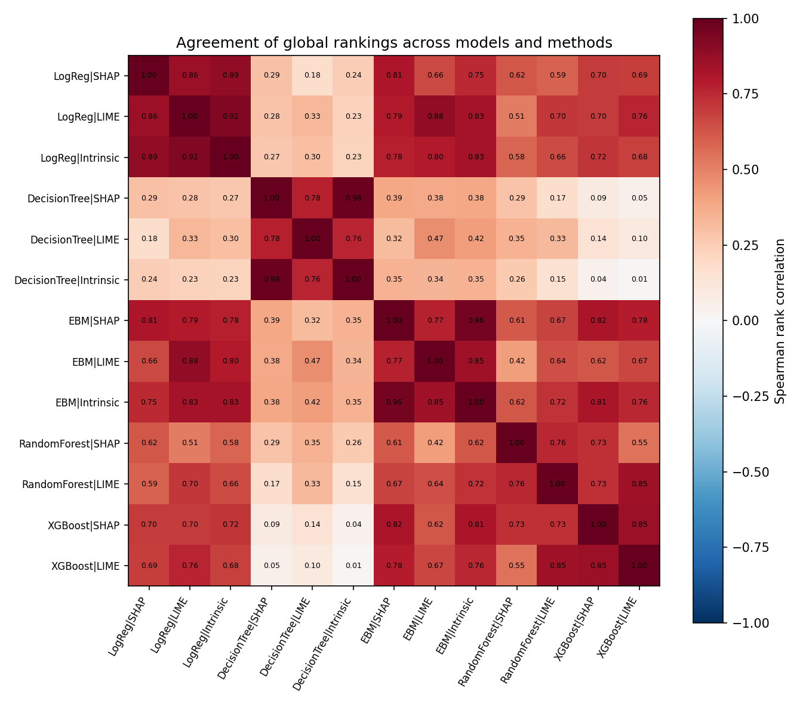
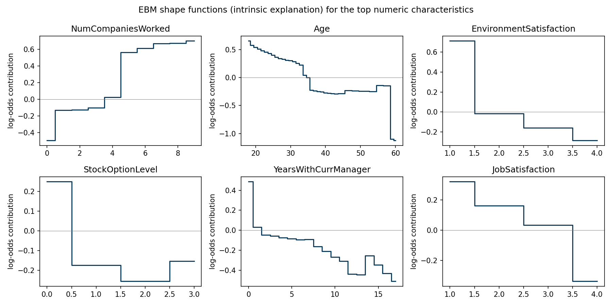
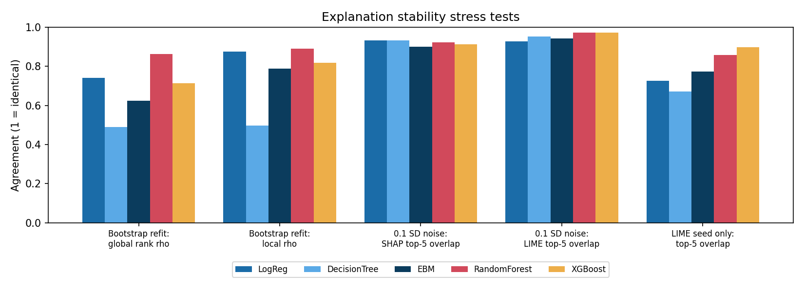
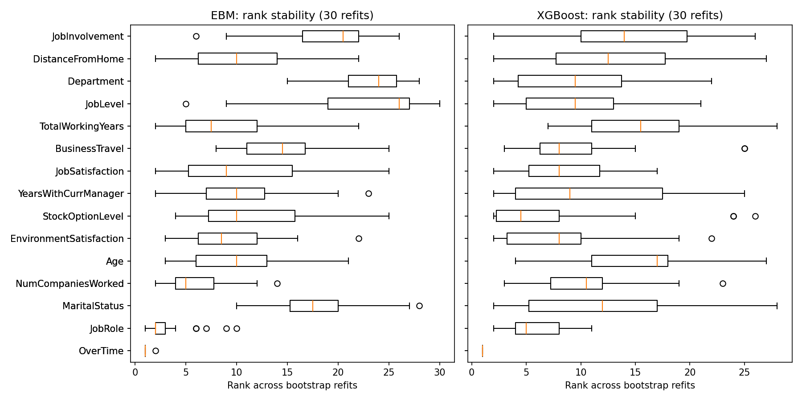
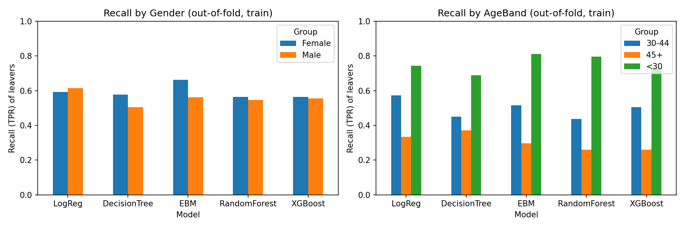

# 1. Problem Definition and Research Focus

## 1.1 Problem Statement

Employee turnover is expensive. When an experienced employee leaves, the organisation pays for recruitment, spends hiring-manager time, loses productivity while the post is empty, and loses knowledge that is not written down anywhere. A retention conversation costs a small fraction of this. Predicting who is likely to leave has therefore become one of the most studied problems in HR analytics. The literature reports that this can be done well: Alqahtani et al. (2024) reviewed studies from 2019 to 2024 and found that tree ensembles and neural approaches consistently produce strong predictive results.

A list of at-risk employees does not, however, tell an HR manager what to do. The manager must decide whom to approach, what to offer, and how to justify the decision if it is challenged. Two employees can have the same risk score for completely different reasons. One may be working sustained overtime, which the organisation can change. The other may score high because of age and marital status, which the organisation cannot change and must not act on. The only difference between the two cases is the *reason* behind the score. For HR use, explainability is therefore a functional requirement, not an optional extra.

Applied work usually handles this requirement in the same way: a black-box model is fitted, a post-hoc explainer (almost always SHAP or LIME) is added, and the resulting feature-importance chart is published as the finding. This study challenges two weaknesses of that practice. First, the explanations are rarely tested. A post-hoc explanation approximates the model, not the world. LIME samples a random neighbourhood, so two runs can disagree. SHAP is deterministic for a fixed model, but the model itself depends on one sample of data, and a slightly different set of employees can produce a different ranking. Second, the interpretable alternative is rarely taken seriously. Rudin (2019) argues that high-stakes decisions should use an intrinsically interpretable model wherever one performs comparably, because such a model *is* its own explanation. Attrition studies usually include an interpretable model only as a baseline for the black box to beat.

The problem addressed by this project can therefore be stated as follows. HR attrition studies routinely publish post-hoc explanations without testing their stability, and they rarely check whether a model that needs no explanation would perform just as well. Without that evidence, neither a feature ranking nor an individual risk explanation can be defended when an HR decision based on it is challenged.

## 1.2 Context and Motivation

Retention decisions affect pay, progression and treatment at work. If an HR team acts on a model, it must be able to show that the model's reasons are meaningful, controllable by the organisation, and not discriminatory. In the United Kingdom, the Equality Act 2010 makes age, sex, and marriage and civil partnership protected characteristics. UK data-protection law also restricts decisions about people that are based solely on automated processing (Information Commissioner's Office [ICO], 2023). A risk score with no reason attached, or with a reason that changes when it is recomputed, gives an organisation little protection against a challenge.

The project is also motivated by a methodological gap. The machine-learning literature has shown that explanation methods can disagree (Krishna et al., 2022) and can be fragile under small changes to the input (Alvarez-Melis & Jaakkola, 2018). These findings have not, however, been carried into applied attrition research. Applied studies typically publish one bar chart from one fitted model and do not ask whether it would survive being computed again.

## 1.3 Aim

The aim of the project is to evaluate whether explanations of employee-attrition models are consistent, stable and defensible enough to support HR decisions, and whether an intrinsically interpretable model can replace a black-box model without a meaningful loss in predictive performance.

## 1.4 Objectives

1. To build a reproducible pipeline that trains three glass-box models (logistic regression, a pruned decision tree and an Explainable Boosting Machine) and two black-box models (random forest and XGBoost) on one shared feature encoding of the IBM HR Analytics dataset.
2. To compare four class-imbalance strategies inside cross-validation, and to evaluate the models with imbalance-appropriate metrics (PR-AUC, ROC-AUC, recall, precision and F1) rather than accuracy.
3. To quantify the predictive cost of interpretability, with confidence intervals.
4. To explain every model with SHAP and LIME and to measure how far the resulting rankings agree across models and methods.
5. To stress-test the explanations by bootstrap refitting, input perturbation and LIME seed variation, and to compare SHAP with LIME for each employee.
6. To audit predictions by gender and age band and to measure how much each model relies on protected attributes.
7. To translate the evidence into practitioner guidance that grades each characteristic by stability and actionability.

## 1.5 Research Questions

- **RQ1.** Which employee characteristics are the strongest predictors of attrition, and how consistent are they across models and explanation methods?
- **RQ2.** How does an intrinsically interpretable model compare with a black-box model on predictive performance, and what is the cost of interpretability?
- **RQ3.** To what extent can XAI outputs be translated into actionable, defensible guidance for HR managers?

RQ1 and RQ3 are deliberately framed around consistency and defensibility rather than importance alone. The question is not only which features a model nominates, but whether the nomination survives being asked again.

## 1.6 Significance of the Study

The study offers four contributions. First, it gives a like-for-like comparison of glass-box and black-box attrition models. All five models use one encoding and one tuning protocol, and the cost of interpretability is reported as a paired difference with a confidence interval rather than as two point estimates. Second, it provides a quantitative stability analysis of global and local explanations under three separate stress tests. Third, it compares SHAP and LIME directly, employee by employee, on the same model. Fourth, it turns these results into a tiered guidance note for HR practitioners that is based on stability evidence rather than on a single feature ranking. Along the way, the subgroup audit found an exact proxy in the data: every employee whose marital status is Single has a stock-option level of zero. This illustrates why removing protected columns does not, on its own, make a model fair.

The scope is binary attrition classification on the IBM HR Analytics dataset, the five models listed above, SHAP and LIME, agreement and stability analysis, and a subgroup audit. Live deployment, collection of new employee data, causal estimation of intervention effects, time-to-event modelling and recommendations about identified individuals are outside the scope.

# 2. Literature Review and Theoretical Framework

## 2.1 Theoretical Framework: Faithfulness, Stability and Actionability

This study evaluates an explanation by asking three separate questions about it.

**Faithfulness** asks whether the explanation describes what the model actually does. Post-hoc explanations are approximations, so they can be unfaithful by construction. An intrinsically interpretable model is faithful by definition, because the explanation is the model (Rudin, 2019).

**Stability** asks whether the explanation stays the same when nothing important has changed. This can be tested at three levels. The training sample can change slightly (model-level stability). The employee's data can change by a negligible amount (input-level stability). The explainer can be run again with a different random seed (method-level stability). An explanation that is faithful but unstable is a faithful account of one model among many that the same data could have produced.

**Actionability** asks whether the organisation can legitimately act on the reason. A reason can be stable and faithful and still be useless or unlawful as a basis for action. Examples are age, which is protected, and the number of previous employers, which is historical.

These three properties are independent. Most applied studies report importance without testing any of them. This framework structures the analysis in Chapter 6: RQ2 concerns the faithfulness argument, RQ1 concerns consistency and stability, and RQ3 combines all three.

## 2.2 Machine Learning for Attrition Prediction

Alqahtani et al. (2024) review attrition-prediction studies from 2019 to 2024. Tree ensembles (random forests and gradient boosting) and neural networks consistently achieve strong headline results, and the IBM HR Analytics dataset (IBM, 2016) is the most common benchmark. The review also shows how fragmented practice is. Studies differ in their datasets, handle class imbalance differently, and choose different evaluation metrics. Many report accuracy on a target where about 84% of employees stay, so a model that predicts that nobody leaves already scores close to 84%. The synthesis therefore shows that attrition can be predicted. It does not show that results can be compared across studies, and it does not show that the results have been interpreted soundly.

## 2.3 Post-hoc Attribution: SHAP and LIME

Lundberg and Lee (2017) unified additive feature-attribution methods under the Shapley value from cooperative game theory. SHAP values satisfy local accuracy (the attributions sum to the prediction), missingness and consistency, properties that earlier importance measures did not guarantee. Exact, efficient algorithms for tree ensembles made SHAP practical for tabular models, and it is now the default explanation tool in applied HR analytics.

Ribeiro et al. (2016) proposed LIME, which explains a single prediction by fitting a sparse linear surrogate to the model's outputs on randomly perturbed samples near the instance. LIME works with any model and is intuitive to read. However, it depends on how the neighbourhood is sampled, how features are discretised and how the kernel is configured. Two runs on the same prediction can therefore differ. Both methods describe the behaviour of the model, not causal structure in the world. Applied studies rarely report either limitation.

## 2.4 Robustness and Disagreement of Explanations

Alvarez-Melis and Jaakkola (2018) showed that popular explanation methods can change a great deal when the input changes very slightly. This is a robustness failure, and it undermines trust in an explanation for a single individual. Krishna et al. (2022) documented a "disagreement problem": different explanation methods often rank features differently for the same prediction, and practitioners settle these disagreements informally, often by choosing the explanation that matches their prior beliefs. Together, these results suggest that the agreement and stability of explanations should be measured rather than assumed. That is especially true in a domain such as HR, where an explanation may be used to justify treating a particular person differently.

## 2.5 Intrinsically Interpretable Models

Rudin (2019) argues that the attention given to explaining black boxes is misplaced for high-stakes decisions. Post-hoc explanations are necessarily imperfect approximations. On structured data with meaningful features, interpretable models often perform as well as black boxes, so the black box brings risk without benefit. Generalised additive models (GAMs) are a strong candidate for tabular data. Lou et al. (2013) showed that GAMs with boosted shape functions, optionally with a small number of pairwise interactions, can approach the accuracy of full-complexity models. The Explainable Boosting Machine (EBM), implemented in InterpretML (Nori et al., 2019), puts this idea into practice. Each feature's contribution is a learned function that can be plotted and read directly, and the prediction is the sum of these contributions. The IBM dataset has 1,470 rows of structured, mostly monotone tabular features, which is the kind of setting where Rudin's argument should be most plausible. It is still rarely tested in attrition research.

## 2.6 Class Imbalance and Evaluation Methodology

About 16% of employees in the dataset leave. SMOTE (Chawla et al., 2002) is the most widely used resampling technique: it creates synthetic minority examples by interpolating between neighbours. Two methodological points matter here. First, resampling must happen only inside the training folds. If it is applied before cross-validation, synthetic points derived from validation rows leak into training, and the scores become optimistic. Second, when the positive class is rare, precision–recall analysis is more informative than ROC analysis or accuracy (Saito & Rehmsmeier, 2015). This study therefore selects models by PR-AUC and reports recall, precision and F1 at an explicitly chosen threshold.

## 2.7 Synthesis: Positioning This Study

The literature shows that attrition can be predicted (Alqahtani et al., 2024) and that explanations can be produced (Lundberg & Lee, 2017; Ribeiro et al., 2016). It also shows, outside the HR domain, that explanations can be fragile and can disagree with one another (Alvarez-Melis & Jaakkola, 2018; Krishna et al., 2022), and that the interpretable alternative deserves serious consideration (Rudin, 2019). No attrition study known to the author does all of the following together:

- compares glass-box and black-box models on one shared encoding, with a confidence interval on the performance difference;
- tests the explanations for stability at the model, input and method levels;
- compares SHAP with LIME for each employee;
- turns the results into guidance that separates robust, actionable reasons from unstable or protected ones.

This project addresses that combination. Its starting assumption is that the explanation, not the model's accuracy, is the object under test.

# 3. Research Design and Methodology

## 3.1 Research Paradigm and Design

The study follows a positivist, quantitative and experimental design using secondary data. The explanations, the models and the data are all fixed and observable, and the questions are answered by measurement: the difference in PR-AUC between models, rank correlations between explanations, and agreement under repeated computation. No participants are recruited. All design decisions were fixed before the stress tests were run, apart from one reporting change that is disclosed in Section 5.3. Every random process uses a single seed (42), and every model is trained on a single CPU thread, so repeated runs give the same results (Section 3.11).

## 3.2 Data

The IBM HR Analytics Employee Attrition & Performance dataset (IBM, 2016) is a fictional dataset created by IBM data scientists to resemble real HR records. It has 1,470 rows and 35 columns (34 employee features plus the Attrition target), and 237 employees (16.1%) left. The data contain no real personal information, which removes privacy risk. For the same reason, the results cannot be generalised to a real workforce (Section 3.11). The file was obtained from IBM's public repository, which contains the same data as the Kaggle copy. The pipeline checks its SHA-256 checksum before running, so any change to the data stops the analysis.

## 3.3 Preprocessing

Four columns were removed: three constants (EmployeeCount, Over18 and StandardHours) and one identifier (EmployeeNumber). This left 30 employee characteristics, seven of them categorical. The categorical variables were fully one-hot encoded, giving 51 model columns that all five models share. A shared encoding means that any disagreement between the explanations reflects the models and not differences in preprocessing. Numeric columns were standardised, with the scaler fitted only on training rows inside each fold. For reporting, attributions on one-hot columns were summed back to their parent characteristic, so that every ranking refers to the 30 characteristics an HR manager would recognise.

The data were split once into stratified training and test sets (80/20): 1,176 training employees and 294 test employees, 47 of whom left. All model selection used stratified 5-fold cross-validation on the training set. The test set was used only for final evaluation and for explanations.

## 3.4 Models, Imbalance Handling and Tuning

Table 1 lists the five models and the hyper-parameter grids searched.

**Table 1**

*Models and Hyper-parameter Grids*

| Type | Model | Grid searched |
|---|---|---|
| Glass-box | Logistic regression (L2) | C ∈ {0.01, 0.1, 1} |
| Glass-box | Decision tree | max_depth ∈ {3, 4, 5}; min_samples_leaf ∈ {10, 25} |
| Glass-box | EBM, additive (no interactions) | max_leaves ∈ {2, 3} |
| Black-box | Random forest, 300 trees (Breiman, 2001) | max_depth ∈ {None, 8}; min_samples_leaf ∈ {1, 5} |
| Black-box | XGBoost, 300 rounds, learning rate 0.05 (Chen & Guestrin, 2016) | max_depth ∈ {2, 3, 4} |

The EBM was deliberately kept purely additive, so that each term corresponds to exactly one feature. The whole model can then be read from its shape functions, and its contributions are exact SHAP values for an additive model.

Four imbalance strategies were crossed with every grid point:

- no adjustment;
- balanced class weighting, applied as sample weights so that the same mechanism works for all five models;
- random oversampling;
- SMOTE.

Resampling was applied only to the training folds. For each model, the combination of strategy and hyper-parameters with the highest mean cross-validated PR-AUC was selected. The decision threshold was then chosen to maximise F1 on the out-of-fold training predictions and applied unchanged to the test set. The threshold is therefore never tuned on test data.

## 3.5 Evaluation of Predictive Performance

The metrics were ROC-AUC, PR-AUC (average precision), and recall, precision and F1 at the selected threshold. Accuracy was not used, because a majority-class predictor already achieves 83.9%. The cost of interpretability was estimated as the difference between each glass-box model and the best black-box model in two ways:

- a paired bootstrap on the test set, using 2,000 resamples of the same test employees and a 95% percentile interval;
- the fold-paired difference in cross-validated PR-AUC.

## 3.6 Explanation Methods

SHAP values were computed for all 294 test employees, using the most exact method available for each model:

- linear SHAP (coefficient × (value − training mean)) for logistic regression;
- the EBM's own centred term contributions, which equal SHAP values for an additive model;
- TreeSHAP for the decision tree, random forest and XGBoost.

LIME was run with default settings (5,000 samples, quartile discretisation, one-hot columns treated as categorical) on a fixed panel of 50 test employees: 25 randomly chosen leavers and 25 randomly chosen stayers. The intrinsic explanations of the glass-box models were also recorded: standardised absolute coefficients for logistic regression, term importances for the EBM, and impurity importances for the decision tree. Global importance was defined as the mean absolute attribution. Agreement between global rankings was measured with Spearman's rank correlation (ρ) and with the Jaccard overlap of the top-10 characteristics. SHAP outputs are in probability units for the decision tree and random forest and in log-odds for the other models. Only rank-based comparisons are made, so the difference in scale does not affect any result.

## 3.7 Stability Stress Tests

Three tests were designed so that each changes one thing and holds everything else fixed.

1. **Bootstrap refit (model-level).** Each model was refitted, with its selected configuration, on 30 bootstrap resamples of the training set, and SHAP was recomputed on the test set each time. The test recorded four things:
   - the Spearman correlation of each refit's global ranking with the full-data ranking;
   - the mean correlation of each employee's local attributions;
   - how often each characteristic appeared in the top 10;
   - the spread of each employee's predicted risk.
2. **Input perturbation (input-level).** With the model fixed, Gaussian noise of 0.1 training standard deviations was added to the 13 continuous inputs. This was repeated 10 times, and SHAP was recomputed each time. LIME was recomputed once on the panel, with its seed held fixed, so that only the input changed.
3. **LIME seed only (method-level).** LIME was re-run with five different seeds and nothing else changed, and all ten pairs of runs were compared.

SHAP and LIME were also compared for each employee on the same model. The measures were local ρ, top-5 Jaccard overlap, agreement on the top-1 feature, and sign agreement on SHAP's top five features.

## 3.8 Subgroup Audit

Predictions were audited by gender and by age band (<30, 30–44, 45+). For each group, the audit reports the base rate, selection rate, true-positive rate, false-positive rate and precision. It uses two sets of predictions: the out-of-fold training predictions (n = 1,176), which form the primary evidence because the groups are larger, and the test predictions (n = 294). Two further analyses were carried out. The first measured the share of total SHAP importance attributable to age, gender and marital status. The second was an ablation that neutralised those three attributes and repeated the cross-validation.

## 3.9 From Evidence to Guidance

Each of the 30 characteristics was given an actionability label in advance, independently of any model: actionable, partly actionable, historical, protected/personal, or unclear meaning. It was then assigned to one of five tiers using this label and the stability evidence:

- **Tier A:** robust (in the SHAP top 10 for at least four of the five models, with a mean bootstrap top-10 frequency of at least 0.7) and actionable.
- **Tier B:** moderately stable (at least three models, frequency of at least 0.4) and actionable.
- **Tier H:** consistent but historical.
- **Tier P:** consistent but protected.
- **Tier C:** weak or unstable.

Explanation cards were then produced for three test employees. Each card shows a 90% interval for the predicted risk, taken from the bootstrap refits.

## 3.10 Tools

The pipeline is written in Python 3.13. It uses scikit-learn for preprocessing, logistic regression, the decision tree, the random forest and the metrics; XGBoost; imbalanced-learn for oversampling and SMOTE; InterpretML for the EBM; SHAP; LIME; pandas; and matplotlib. Exact versions are pinned in `requirements.txt`.

## 3.11 Validity, Reliability and Limitations

**Internal validity.** Information leakage was prevented by fitting the scaler and resampler inside each fold, choosing the threshold on out-of-fold predictions only, and keeping the test set out of model selection. Every model shares one encoding, so differences between explanations cannot come from preprocessing.

**Reliability.** The whole analysis runs from one command with one seed. Two complete runs from a fresh environment, and an execution of the notebook version, produced byte-identical result files on the same machine (Section 4.3). An earlier version trained the random forest, XGBoost and the EBM on several CPU threads. When that version was run on a second computer, those three models gave slightly different numbers; for the random forest a different configuration was even selected, because two settings were almost tied on CV PR-AUC. The pipeline was therefore changed to run on a single thread, and every number in this report comes from that version. Small floating-point differences between different processors or operating systems cannot be ruled out completely, but in the comparison above they only moved the later decimal places and did not change any conclusion.

**Statistical conclusion validity.** The test set contains only 47 leavers, so differences in test-set performance are reported with paired-bootstrap intervals and checked against fold-paired cross-validation differences. Subgroup findings rely mainly on out-of-fold predictions because the test subgroups are small.

**External validity** is the main limitation. The data are fictional, so the findings describe how the methods behave on realistic HR-style data, not what drives attrition in a real organisation.

**Construct limitations.**

- The actionability labels involve judgement.
- SMOTE applied to one-hot columns produces fractional dummy values. SMOTE-NC would be more principled. SMOTE was selected only for the black-box models, and by margins within noise, so this does not change any conclusion.
- Hyper-parameter grids were kept small and equal across models. More extensive tuning could change the black-box results slightly.
- No result supports a causal claim.

# 4. Artefact Design and Development

## 4.1 Artefact Overview and Tools

The artefact is a reproducible Python pipeline. The same code is provided in two forms: a single script, `attrition_xai.py`, which is the canonical version, and a notebook, `attrition_xai.ipynb`, which is generated from the script and contains all tables and figures inline. One command runs the whole study in about 21 minutes (measured on an 8-core Linux machine; the pipeline deliberately uses one CPU thread, see Section 4.3) and writes 16 result tables, a JSON summary, the explanation cards and 8 figures. A practitioner guidance note and this report complete the deliverables. The design choices put three properties first: reproducibility (one seed, a checksummed data file and pinned dependencies), fair comparison (one encoding and one tuning protocol for every model) and transparency (every number in this report can be traced to a file in `results/`).

## 4.2 How the Artefact Is Structured

Figure 1 shows the architecture of the study, and Table 2 explains each part.

**Figure 1**

*Research Architecture of the Study*

{width=6.2in}

**Table 2**

*The Parts of the Artefact and the Reason for Each Choice*

| Part | What it does | Rationale |
|---|---|---|
| Data loader | Verifies SHA-256, drops 4 columns, one-hot encodes to 51 columns | Guarantees identical input on every run; one shared encoding for all models |
| `fit` / `Fitted` | Fits scaler, optional resampler and model on training rows; wraps prediction | Prevents leakage; scaling and resampling never see validation or test rows |
| CV selection | 5-fold CV over 4 strategies × grid; picks best CV PR-AUC; F1-optimal threshold from out-of-fold | Imbalance-appropriate selection; threshold never tuned on test data |
| Explainers | Exact linear SHAP, EBM term contributions, TreeSHAP, LIME, intrinsic importances | Most faithful explainer per model; attributions grouped to 30 characteristics |
| Stress tests | Bootstrap refit, 0.1 SD perturbation, LIME seed-only, SHAP vs LIME | Each test changes one thing, isolating model-, input- and method-level stability |
| Audit | Subgroup rates, protected-attribute share, ablation | Governance evidence beyond inputs alone |
| Guidance layer | Tiers, explanation cards with bootstrap intervals, figures | Turns measurements into decisions an HR manager can defend |

## 4.3 Development and Testing

The pipeline was built step by step, and each stage was checked before the next was added. A reduced smoke-test configuration was run first. It used one hyper-parameter value per model, two imbalance strategies, two bootstrap refits and a six-employee LIME panel, and it exercised every code path in under a minute. This caught a mistyped checksum constant, which the data guard reported immediately. As a sanity check, the SHAP rankings of the glass-box models were compared with their intrinsic importances. They agree at ρ = 0.89 for logistic regression and 0.96 for the EBM. The small gaps are expected, because the intrinsic measures (standardised coefficients and term importances) average slightly different quantities.

Reproducibility was tested directly. The full pipeline was run twice from a fresh virtual environment, and the notebook was executed separately. All result tables were byte-identical between the runs; only the runtime recorded in `summary.json` differs. Determinism comes from passing the seed to every model, resampler, bootstrap generator and LIME explainer, from drawing the LIME panel and perturbation noise from seeded generators, and from training every model on a single CPU thread. The last point was added late in the project. With several threads the pipeline took about 5 to 9 minutes, but its results moved slightly from one computer to another (Section 3.11). Running on one thread is slower but gives stable results, which matters more for a study about stability.

## 4.4 What the Artefact Produces and Its Limits

The artefact produces the following outputs:

- every cross-validation result for each model, strategy and parameter combination;
- the selected configurations and their test metrics;
- paired-bootstrap differences in performance;
- global importances, rankings and agreement matrices;
- SHAP–LIME agreement for each employee;
- the stability tables;
- the subgroup audit and ablation;
- the feature tiers and the explanation cards.

It is a research artefact, not a deployable HR system. It contains no user interface, does no monitoring, and is not designed to score real employees. It also fixes one train/test split, so the test-set estimates carry the sampling uncertainty described in Section 3.11.

# 5. Project Management

## 5.1 Planning and Milestones

The project followed the 15-week plan set out in the proposal. The most important dependency was the choice of imbalance strategy: every later result depends on the selected configurations, so changing it late would have invalidated the explanation and stability results. For that reason, the strategy comparison was built into the same cross-validation loop as model selection and was completed before any explanation work began. Table 3 summarises the milestones.

**Table 3**

*Project Milestones and Outcomes*

| Weeks | Planned milestone | Outcome |
|---|---|---|
| 1–3 | Literature review, data acquisition, exploratory analysis | Review completed; checksummed data loader; base rates established (16.1% attrition) |
| 4–6 | Preprocessing, imbalance strategies, glass-box models | Shared 51-column encoding; four strategies inside CV; LogReg, decision tree, EBM |
| 7–9 | Black-box models, tuning, performance comparison | Random forest and XGBoost; grid tuning; paired-bootstrap cost of interpretability |
| 10–12 | SHAP and LIME; stability, agreement and fairness analyses | Three stress tests; SHAP vs LIME; subgroup audit; ablation |
| 13–15 | Guidance note, report, repository | Guidance note, report, notebook, README and pinned requirements |

## 5.2 Risk Management

Table 4 lists the principal risks identified in the proposal and what happened to each.

**Table 4**

*Principal Project Risks, Mitigations and Outcomes*

| Risk | Mitigation | Outcome |
|---|---|---|
| Interpretable models perform weakly | Treat as a valid finding and report it | Did not occur for EBM or logistic regression; the decision tree did underperform and is reported |
| Unstable LIME explanations | Fix seeds; measure and report the variation | Quantified as a finding (Section 6.4) rather than hidden |
| Over-claiming correlational results | Correlational language; synthetic-data caveat; no causal claims | Applied throughout; guidance note states the limits explicitly |
| Imbalance strategy changed late, invalidating results | Resolve strategy selection first, inside the same CV loop | Strategy fixed before explanation work; no rework needed |
| Data or dependency drift | SHA-256 data check; pinned versions; single seed; single-threaded training | Byte-identical results across repeated runs on the same machine; multithreading drift between computers found and removed (Section 3.11) |

## 5.3 Adaptations and Challenges

The project needed two adaptations. First, the original tiering rule had only two levels, robust or not. After the first full run, it placed only two of the 30 characteristics in an actionable tier and merged everything else into one "unstable" category. That hid a meaningful difference between characteristics that were moderately consistent (in the top 10 for three models and in about half of the bootstrap refits) and characteristics that never ranked highly. The rule was therefore refined to the five tiers in Section 3.9. The refinement changed only how existing measurements are reported. No model, explanation or stability result changed, and the two robust characteristics are the same under both rules.

Second, the subgroup analysis showed that StockOptionLevel, labelled in advance as actionable, is an exact proxy for marital status in this dataset. The guidance was therefore extended with a proxy warning, so that an actionable label is not taken to mean that a feature is safe to use.

## 5.4 Reflection

The most useful lesson of the project was methodological. The central results came from re-running the analysis, not from running it once. A single SHAP chart from one model would have supported a confident list of drivers. Repeating the computation showed that only two of those drivers are robust. Fixing the evaluation protocol early also proved valuable: deciding on PR-AUC, nested resampling and an out-of-fold threshold before seeing any results removed the temptation to choose favourable metrics afterwards. If the project were repeated, the bootstrap analysis would be extended to the decision threshold, so that the uncertainty in each employee's flag could be reported directly. SMOTE-NC would also be used for the mixed categorical data.

# 6. Evaluation and Discussion

## 6.1 Class-Imbalance Strategies

Table 5 and Figure 2 show the best cross-validated PR-AUC for each model under each strategy.

**Table 5**

*Best Cross-validated PR-AUC by Model and Imbalance Strategy*

| Model | None | Class weight | Oversample | SMOTE |
|---|---|---|---|---|
| Logistic regression | **0.651** | 0.630 | 0.613 | 0.615 |
| Decision tree | **0.391** | 0.379 | 0.386 | 0.333 |
| EBM | **0.687** | 0.675 | 0.549 | 0.665 |
| Random forest | 0.574 | 0.568 | 0.567 | **0.594** |
| XGBoost | 0.639 | 0.618 | 0.602 | **0.643** |

**Figure 2**

*Cross-validated PR-AUC by Class-imbalance Strategy*

{width=6.2in}

Rebalancing did not help the glass-box models. For the black-box models, SMOTE improved PR-AUC only slightly (by 0.004 to 0.020), and these gains are smaller than the fold-to-fold standard deviation of about 0.05. This is what one would expect. PR-AUC does not depend on the decision threshold, and rebalancing mostly moves the operating point, which threshold tuning can do directly. Random oversampling clearly harmed the EBM (0.549), probably because duplicated minority rows encourage its shape functions to overfit. The practical lesson is that, for this kind of data, the imbalance strategy matters much less than evaluating correctly and choosing the threshold explicitly.

## 6.2 Predictive Performance and the Cost of Interpretability (RQ2)

Table 6 and Figure 3 report the selected configurations.

**Table 6**

*Cross-validated and Held-out Test Performance of the Selected Models*

| Model | Type | Strategy | CV PR-AUC | Test ROC-AUC | Test PR-AUC | Recall | Precision | F1 |
|---|---|---|---|---|---|---|---|---|
| Logistic regression | Glass | none | 0.651 ± 0.061 | 0.812 | **0.584** | 0.447 | **0.553** | **0.494** |
| Decision tree | Glass | none | 0.391 ± 0.046 | 0.684 | 0.310 | 0.447 | 0.389 | 0.416 |
| EBM | Glass | none | **0.687 ± 0.050** | **0.828** | 0.578 | 0.447 | **0.553** | **0.494** |
| Random forest | Black | SMOTE | 0.594 ± 0.049 | 0.794 | 0.497 | **0.511** | 0.462 | 0.485 |
| XGBoost | Black | SMOTE | 0.643 ± 0.060 | 0.811 | 0.565 | 0.468 | 0.500 | 0.484 |

*Note.* The no-skill PR-AUC on the test set is 0.160. A majority-class predictor reaches 83.9% accuracy with zero recall.

**Figure 3**

*Precision–Recall Curves on the Held-out Test Set*

{width=4.6in}

Table 7 gives the cost of interpretability. Each glass-box model is compared with XGBoost, the best black-box model by cross-validation.

**Table 7**

*Glass-box Minus Best Black-box Performance With 95% Bootstrap Intervals*

| Glass-box | Test PR-AUC Δ [95% CI] | Test ROC-AUC Δ [95% CI] | CV PR-AUC Δ (fold range) |
|---|---|---|---|
| EBM | +0.013 [−0.038, 0.067] | +0.017 [−0.007, 0.041] | +0.044 (−0.003 to 0.076) |
| Logistic regression | +0.019 [−0.058, 0.096] | +0.000 [−0.039, 0.039] | +0.008 (−0.010 to 0.021) |
| Decision tree | −0.255 [−0.362, −0.131] | −0.127 [−0.205, −0.057] | −0.252 (−0.292 to −0.219) |

On this dataset, neither the EBM nor logistic regression shows any measurable cost of interpretability. Their point estimates are either zero or in favour of the glass-box model, and all of their intervals include zero. The EBM also beat XGBoost in four of the five cross-validation folds. Only the depth-4 decision tree pays a large and significant penalty, so "interpretable" should not be equated with "a shallow tree". The black-box models reach higher recall at the selected threshold only by accepting lower precision, which is a choice of operating point that any model could make. The superiority of ensembles that the attrition literature often reports is therefore not reproduced here. These results support Rudin's (2019) position for this setting: the black box adds opacity without adding predictive value.

## 6.3 Strongest Predictors and Their Consistency (RQ1)

Figure 4 shows each characteristic's share of importance and its rank under each model and method. Figure 5 shows how well the rankings agree.

**Figure 4**

*Top-15 Characteristics by Consensus SHAP Rank (cell text is the rank within each column)*

{width=6.3in}

**Figure 5**

*Spearman Agreement Between Global Rankings Across Models and Methods*

{width=5.2in}

**What is consistent.** OverTime ranks first under SHAP in all five models and under LIME in all five models. The intrinsic explanations rank it second or third. In the raw data, 30.5% of employees who work overtime left, compared with 10.4% of those who do not. JobRole ranks between second and sixth for every model except the decision tree, which ranks it ninth. Attrition ranges from 2.5% for Research Directors to 39.8% for Sales Representatives. These two characteristics are the only robust findings.

**What is less consistent.** Among the four competitive models, the global SHAP rankings agree only moderately. Spearman's ρ ranges from 0.61 (EBM vs random forest) to 0.82 (EBM vs XGBoost). The top-10 lists overlap with a Jaccard index of 0.25 to 0.67, which means the models share only 4 to 8 of their 10 most important characteristics. The decision tree hardly agrees with any other model (ρ = 0.09 to 0.39) because it uses only a few features.

**Correlated features trade places.** MonthlyIncome ranks second to fourth for the decision tree but 25th for logistic regression and 22nd for XGBoost. Income is correlated with JobLevel (r = 0.95) and TotalWorkingYears (r = 0.77), and each model distributes the shared signal differently. Similarly, StockOptionLevel ranks second for XGBoost but 16th for logistic regression, while MaritalStatus ranks second to fifth for the random forest, EBM and decision tree but 13th for XGBoost. The data explain why: all 470 single employees have a stock-option level of zero. The two features are interchangeable proxies, and each model picks one of them.

**Agreement between methods.** On the same model, the global rankings from SHAP and LIME agree well (ρ = 0.76 to 0.86). The intrinsic rankings of the glass-box models agree closely with their SHAP rankings (logistic regression 0.89, EBM 0.96, decision tree 0.98). XGBoost's SHAP ranking agrees more with the EBM's intrinsic ranking (0.81) than with the random forest's SHAP ranking (0.73). In other words, explaining the black box after the fact recovers broadly the same story that the transparent model provides directly.

The EBM shape functions in Figure 6 show what this story looks like when no approximation is involved. The risk of leaving rises sharply after four or more previous employers. It falls steadily with age up to the mid-thirties. It is highest at the lowest environment-satisfaction and job-satisfaction scores, at a stock-option level of zero, and in the first year with the current manager.

**Figure 6**

*EBM Shape Functions: The Glass-box Model's Own Explanation for Six Numeric Characteristics*

{width=6.2in}

**Answer to RQ1.** OverTime, followed by JobRole, are the strongest and most consistent predictors. A second group follows: EnvironmentSatisfaction, NumCompaniesWorked, JobSatisfaction, StockOptionLevel or MaritalStatus, Age and YearsWithCurrManager. The order within this group depends on the model. Beyond these, the rankings are not robust enough to interpret.

## 6.4 Stability of the Explanations

Table 8 and Figures 7 and 8 report the three stress tests.

**Table 8**

*Explanation Stability Under Three Stress Tests*

| Measure | LogReg | DecTree | EBM | RF | XGB |
|---|---|---|---|---|---|
| Bootstrap: global ranking ρ (mean / min) | 0.74 / 0.55 | 0.49 / 0.14 | 0.62 / 0.37 | **0.86 / 0.74** | 0.71 / 0.51 |
| Bootstrap: local ρ (mean per employee) | 0.88 | 0.50 | 0.79 | **0.89** | 0.82 |
| Bootstrap: SD of predicted risk | **0.051** | 0.122 | 0.084 | 0.054 | 0.082 |
| 0.1 SD noise: SHAP local ρ | **0.996** | 0.960 | 0.979 | 0.960 | 0.968 |
| 0.1 SD noise: SHAP top-5 Jaccard | 0.93 | 0.93 | 0.90 | 0.92 | 0.91 |
| 0.1 SD noise: LIME top-5 Jaccard (seed fixed) | 0.93 | 0.95 | 0.94 | 0.97 | 0.97 |
| LIME seed only: top-5 Jaccard | 0.73 | 0.67 | 0.77 | 0.86 | 0.90 |
| LIME seed only: top-1 same | 0.92 | 1.00 | 1.00 | 1.00 | 0.72 |

**Figure 7**

*Explanation Stability Stress Tests*

{width=6.3in}

**Figure 8**

*Rank of the Top-15 Characteristics Across 30 Bootstrap Refits (EBM and XGBoost)*

{width=6.3in}

The results lead to four findings.

1. **The explanations are robust to small changes in the input.** Adding noise of 0.1 standard deviations changed predicted probabilities by only 0.008 to 0.030 on average. The SHAP top-5 overlap stayed at about 0.9, and the top-ranked feature was unchanged for 92% to 99% of employees.
2. **The explanations are less robust to which employees were in the training data.** Across the bootstrap refits, the correlation of the global ranking fell to 0.14 for the decision tree, 0.37 for the EBM and 0.51 for XGBoost. In its worst resample, the EBM gave a substantially different global account. The random forest was the most stable, because averaging 300 trees smooths over resampling. Transparency does not by itself make an explanation stable.
3. **LIME's own randomness is larger than realistic noise in the input.** Changing only LIME's seed gave a top-5 overlap of 0.67 to 0.90, whereas perturbing the input with the seed held fixed gave 0.93 to 0.97. A single LIME explanation therefore contains a random component that is larger than the effect of measurement noise in the employee's data. For XGBoost, LIME's top reason changed for more than one employee in four (28%).
4. **Glass-box models do not remove uncertainty in the prediction.** A typical employee's EBM risk moved by 0.084 (standard deviation) across refits. For the borderline employee in Section 6.7, the 90% interval was 0.05 to 0.69, which spans the decision threshold of 0.338.

## 6.5 SHAP Versus LIME for Each Employee

Table 9 compares SHAP and LIME for the same model and the same employee.

**Table 9**

*Employee-level Agreement Between SHAP and LIME on the Same Model*

| Model | Local ρ | Top-5 Jaccard | Top-1 same | Sign agreement (SHAP top 5) |
|---|---|---|---|---|
| LogReg | 0.93 | 0.49 | 0.46 | 1.00 |
| DecisionTree | 0.56 | 0.45 | 0.76 | 0.90 |
| EBM | 0.78 | 0.49 | 0.46 | 0.96 |
| RandomForest | 0.78 | 0.46 | 0.86 | 0.95 |
| XGBoost | 0.80 | 0.43 | 0.42 | 0.98 |

The two methods agree on the direction of the main effects (sign agreement of 0.90 to 1.00). However, they share only about three of their five top reasons (Jaccard of about 0.45), and they name the same top reason for only 42% to 86% of employees. Even for logistic regression, whose exact attributions are known, LIME's top reason matched for only 46% of employees. LIME's discretised surrogate measures something different from SHAP's attribution. An HR manager given "the top three reasons" would therefore receive a different list depending on which tool the analyst happened to use. This is the disagreement problem described by Krishna et al. (2022), measured here on attrition data.

## 6.6 Subgroup Audit

Figure 9 shows recall of leavers by gender and age band.

**Figure 9**

*Recall of Leavers by Gender and Age Band (Out-of-fold Training Predictions)*

{width=6.3in}

Gender gaps were small for every model. The difference in true-positive rate between men and women was 0.01 to 0.10, and the difference in selection rate was at most 0.03. Age-band gaps were large for every model. The EBM caught 81% of leavers under 30, 52% of those aged 30 to 44, and 30% of those aged 45 and over. The corresponding figures for XGBoost were 73%, 51% and 26%. The base rates differ (28.7%, 13.5% and 10.3%), which explains part of the gap. Even so, the models miss most older leavers, so a retention budget allocated by score would go mainly to younger staff.

Age, gender and marital status together account for 9.8% (XGBoost) to 16.4% (decision tree) of total SHAP importance. Neutralising all three reduced cross-validated PR-AUC by at most 0.019 for the competitive models (for XGBoost the change was below 0.001), and by 0.042 for the decision tree. Their information is largely available through proxies: TotalWorkingYears and YearsAtCompany for age, and StockOptionLevel for marital status. Removing the protected columns therefore does not remove the disparity. Governance has to examine outcomes by group, not only the list of inputs.

## 6.7 From Explanations to Guidance (RQ3)

Table 10 assigns every characteristic to a tier.

**Table 10**

*Defensibility Tiers for the 30 Employee Characteristics*

| Tier | Characteristics | Permitted use |
|---|---|---|
| A – robust and actionable | OverTime, JobRole | May open a retention conversation |
| B – moderately stable and actionable | EnvironmentSatisfaction, StockOptionLevel (proxy warning), JobSatisfaction, YearsWithCurrManager | Corroborating evidence only; confirm with the employee |
| H – consistent but historical | NumCompaniesWorked | Context only |
| P – consistent but protected | MaritalStatus, Age | Never a basis for action; monitor for bias |
| C – weak or unstable | The remaining 21, including MonthlyIncome, BusinessTravel, JobLevel, DistanceFromHome | Do not cite as a reason |

The explanation cards show how the tiers work for individual employees:

- **Highest-risk employee** (left; risk 0.98; 90% interval 0.99 to 1.00). Two of the five largest contributions can be defended: OverTime = Yes (+1.05 log-odds) and JobRole = Sales Representative (+0.67). JobInvolvement, MonthlyIncome and BusinessTravel contribute similar amounts, but they are tier C and should not be given as reasons.
- **Borderline employee** (left; risk 0.34; interval 0.05 to 0.69; not flagged). The interval crosses the threshold, so the result should be recorded as uncertain. The leading contributions point in both directions: JobRole = Laboratory Technician (tier A, +0.64) and BusinessTravel (tier C) raise the risk, NumCompaniesWorked (historical) and OverTime = No lower it, and MaritalStatus = Single (protected) raises it. Only the JobRole contribution could be cited, and the marital-status contribution must be ignored. This employee did leave, which shows what an uncertain "not flagged" can hide.
- **A leaver on whom XGBoost's SHAP and LIME disagreed sharply** (top-5 overlap of 0.11). The EBM gives a clear account: OverTime = Yes is the main factor. The model did not flag this employee (risk 0.31; interval 0.01 to 0.67), which illustrates the recall of about 45%.

**Answer to RQ3.** XAI outputs can be turned into defensible guidance, but only partly and only after filtering. Of the 30 characteristics, two are robust and actionable, four more may be used only as supporting evidence, and three must be set aside as protected or historical. Getting from an explanation to guidance requires four things a single SHAP chart does not provide: evidence of stability, an actionability judgement made independently of the model, a check for proxies, and an uncertainty interval for each employee. None of the explanations supports a causal claim such as "reducing overtime will retain this person". These findings are written up in a separate practitioner guidance note.

## 6.8 Discussion

Three themes run through the results. First, the black box was not needed. The EBM, whose every contribution can be read directly, matched XGBoost, and so did logistic regression. This suggests that the advantage of ensembles reported in attrition studies (Alqahtani et al., 2024) partly reflects the use of accuracy as the metric and the use of weak interpretable baselines.

Second, transparency is not the same as stability. Rudin's argument removes the gap between the explanation and the model. It does not remove the gap between the model and the process that generated the data. The EBM's global ranking was *less* stable under bootstrap refitting than the random forest's. A glass-box model gives a faithful account of a model that could easily have been different. This refines Rudin's position rather than contradicting it: faithfulness and stability need to be reported separately.

Third, explanations disagree at exactly the level that matters to HR. At the global level, SHAP and LIME largely agree. At the level of a single employee, which is the level of a retention conversation, they share about three of five reasons, and LIME adds seed noise that is larger than the effect of realistic changes to the input. An explanation that changes when it is re-run cannot be defended.

## 6.9 Strengths, Reliability, Validity and Limitations

The study has several strengths:

- all models share one encoding and one tuning protocol;
- the cost of interpretability is reported as a paired difference with an interval;
- stability is tested at three separate levels;
- the subgroup audit uses out-of-fold predictions, which give the larger groups;
- the whole analysis runs from one command and gives identical results when it is repeated.

It also has limitations:

- The data are fictional, so external validity is limited.
- The test set is small (47 leavers, of whom 9 are aged 45 or over).
- The tuning grids were bounded.
- SMOTE was applied to one-hot columns.
- The actionability labels involve judgement.
- No causal identification was attempted.

These limitations are discussed in Section 3.11. None of them alters the direction of the main findings. In particular, the conclusion that interpretability costs nothing here rests on point estimates that favour the glass-box models, and the instability findings were measured directly.

## 6.10 Results Against the Objectives

Table 11 summarises how each objective was met.

**Table 11**

*Results Against the Objectives*

| Objective | Status | Evidence |
|---|---|---|
| 1. Reproducible five-model pipeline on one encoding | Met | `attrition_xai.py`, notebook; byte-identical repeated runs (single-threaded) |
| 2. Imbalance strategies inside CV; imbalance-aware metrics | Met | Table 5; Table 6 |
| 3. Quantify the cost of interpretability | Met | Table 7: no cost for EBM or LogReg; large cost for the decision tree |
| 4. SHAP and LIME for every model; rank agreement | Met | Figures 4–5; Section 6.3 |
| 5. Three stress tests; SHAP vs LIME per employee | Met | Table 8; Table 9 |
| 6. Subgroup audit and protected-attribute reliance | Met | Figure 9; Section 6.6 |
| 7. Practitioner guidance from stability and actionability | Met | Table 10; guidance note; explanation cards |

# 7. Legal, Ethical and Social Considerations

## 7.1 Research Ethics

The project uses only a fictional, publicly released dataset. It involves no human participants, no interviews or surveys, and no collection of new data. Its ethical risk is therefore low. An ethics application was submitted through the university's ethics monitoring system, as required. The remaining ethical risks lie in how the results might be used, not in how they were obtained. These risks are addressed in Sections 7.3 and 7.4 and in the guidance note.

## 7.2 Data Licences and Terms of Use

The IBM HR Analytics dataset is sample data published by IBM and redistributed on Kaggle (IBM, 2016). In this project it is used only for non-commercial academic research and is cited in full. All software used is open source (scikit-learn, XGBoost, imbalanced-learn, InterpretML, SHAP and LIME), used under the terms of its licence and cited where a scholarly reference exists.

## 7.3 Data Privacy

No personal data are processed, because every record is fictional. However, the methods are designed for use on real employee data, which would raise several data-protection obligations. Under UK data-protection law, a real deployment would need a lawful basis for processing and a data-protection impact assessment, because profiling employees is likely to be high-risk processing. Article 22 of the UK GDPR also restricts decisions based solely on automated processing that significantly affect a person (ICO, 2023). The guidance note therefore positions the model as one input to a decision made by a person, never as the decision itself.

## 7.4 Broader Social and Professional Impact

The audit shows how an attrition model could cause harm even when it is accurate. The models use age and marital status, both of which relate to protected characteristics under the Equality Act 2010. Removing those columns does not stop the model using them, because proxies such as stock-option level carry the same information. The models also detect older leavers much less often, so retention effort guided by the scores would go mainly to younger staff. A responsible deployment would therefore have to:

- monitor outcomes by group;
- exclude protected and proxy reasons from any justification;
- offer interventions to whole groups of employees in the same situation rather than singling out individuals;
- make the allocation of retention effort an explicit governance decision.

These practices are consistent with professional codes that require IT practitioners to have due regard for the rights of third parties and to avoid discrimination (BCS, The Chartered Institute for IT, 2022). The project's positive contribution is to show that an organisation does not have to accept opacity in exchange for accuracy. On this kind of data, a model whose reasoning can be inspected and challenged performs just as well.

# 8. Conclusion and Recommendations

This project set out to test, rather than assume, the quality of explanations from employee-attrition models. It also tested whether an intrinsically interpretable model can replace a black box. Five models were trained on one shared encoding of the IBM HR Analytics dataset, explained with SHAP and LIME, stress-tested in three ways and audited by subgroup.

On **RQ2**, interpretability cost nothing on this dataset. The EBM (test PR-AUC 0.578) and logistic regression (0.584) matched or exceeded XGBoost (0.565) and the random forest (0.497). Every confidence interval for the difference included zero, and the EBM beat XGBoost in four of the five folds. Only a shallow decision tree performed clearly worse.

On **RQ1**, OverTime and JobRole are the strongest and most consistent predictors across every model, every method and every resample. The ranking below them depends on the model and the training sample, and correlated features such as income and job level, or stock options and marital status, trade places from one model to another.

On **RQ3**, the explanations can be turned into defensible guidance only after filtering. Only two characteristics are both robust and actionable. Four more can serve only as supporting evidence. Protected characteristics and their proxies must be excluded explicitly. At the level of a single employee, SHAP and LIME share only about three of five reasons, and LIME varies with its random seed by more than it varies with realistic changes to the input.

**Recommendations for practitioners.**

1. Use an intrinsically interpretable model, such as an EBM or regularised logistic regression, by default. Adopt a black box only if it shows a clear, interval-backed performance advantage.
2. Evaluate with PR-AUC, recall and precision at an explicit threshold, never with accuracy.
3. Before citing any reason, re-run the explanation under bootstrap refits and, if LIME is used, under several seeds. Cite only reasons that survive.
4. Attach an uncertainty interval to each employee's risk. Treat a flag whose interval crosses the threshold as uncertain.
5. Grade each reason for actionability and check it for proxies of protected characteristics before using it.
6. Monitor outcomes by age and gender, because removing protected inputs does not remove the disparity.

**Recommendations for future research.**

- Replicate the protocol on real organisational data under appropriate governance.
- Test whether adding interaction terms to the EBM changes its stability.
- Extend the bootstrap analysis to the decision threshold.
- Use SMOTE-NC for mixed data.
- Combine the defensibility tiers with causal designs that estimate whether reducing overtime actually reduces attrition. This last step is the one that would turn a defensible reason into an effective intervention.

# References

Alqahtani, H., Almagrabi, H., & Alharbi, A. (2024). Employee attrition prediction using machine learning models: A review paper. *International Journal of Artificial Intelligence & Applications, 15*(2), 23–49. https://doi.org/10.5121/ijaia.2024.15202

Alvarez-Melis, D., & Jaakkola, T. S. (2018). *On the robustness of interpretability methods* (arXiv:1806.08049). arXiv. https://doi.org/10.48550/arXiv.1806.08049

BCS, The Chartered Institute for IT. (2022). *BCS code of conduct*. https://www.bcs.org/membership-and-registrations/become-a-member/bcs-code-of-conduct/

Breiman, L. (2001). Random forests. *Machine Learning, 45*(1), 5–32. https://doi.org/10.1023/A:1010933404324

Chawla, N. V., Bowyer, K. W., Hall, L. O., & Kegelmeyer, W. P. (2002). SMOTE: Synthetic minority over-sampling technique. *Journal of Artificial Intelligence Research, 16*, 321–357. https://doi.org/10.1613/jair.953

Chen, T., & Guestrin, C. (2016). XGBoost: A scalable tree boosting system. In *Proceedings of the 22nd ACM SIGKDD International Conference on Knowledge Discovery and Data Mining* (pp. 785–794). https://doi.org/10.1145/2939672.2939785

Equality Act 2010, c. 15. https://www.legislation.gov.uk/ukpga/2010/15/contents

IBM. (2016). *IBM HR Analytics employee attrition and performance* [Data set]. Kaggle. https://www.kaggle.com/datasets/pavansubhasht/ibm-hr-analytics-attrition-dataset

Information Commissioner's Office. (2023). *Guide to the UK General Data Protection Regulation (UK GDPR): Rights related to automated decision making including profiling*. https://ico.org.uk/

Krishna, S., Han, T., Gu, A., Pombra, J., Jabbari, S., Wu, S., & Lakkaraju, H. (2022). *The disagreement problem in explainable machine learning: A practitioner's perspective* (arXiv:2202.01602). arXiv. https://doi.org/10.48550/arXiv.2202.01602

Lou, Y., Caruana, R., Gehrke, J., & Hooker, G. (2013). Accurate intelligible models with pairwise interactions. In *Proceedings of the 19th ACM SIGKDD International Conference on Knowledge Discovery and Data Mining* (pp. 623–631). https://doi.org/10.1145/2487575.2487579

Lundberg, S. M., & Lee, S.-I. (2017). A unified approach to interpreting model predictions. *Advances in Neural Information Processing Systems, 30*, 4765–4774.

Nori, H., Jenkins, S., Koch, P., & Caruana, R. (2019). *InterpretML: A unified framework for machine learning interpretability* (arXiv:1909.09223). arXiv. https://doi.org/10.48550/arXiv.1909.09223

Ribeiro, M. T., Singh, S., & Guestrin, C. (2016). "Why should I trust you?": Explaining the predictions of any classifier. In *Proceedings of the 22nd ACM SIGKDD International Conference on Knowledge Discovery and Data Mining* (pp. 1135–1144). https://doi.org/10.1145/2939672.2939778

Rudin, C. (2019). Stop explaining black box machine learning models for high stakes decisions and use interpretable models instead. *Nature Machine Intelligence, 1*(5), 206–215. https://doi.org/10.1038/s42256-019-0048-x

Saito, T., & Rehmsmeier, M. (2015). The precision-recall plot is more informative than the ROC plot when evaluating binary classifiers on imbalanced datasets. *PLOS ONE, 10*(3), Article e0118432. https://doi.org/10.1371/journal.pone.0118432
