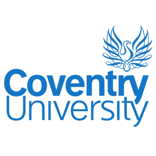

<!--
Cover page, declaration form and Contents page. build_report.py puts this file in front of
DISSERTATION.md. Text in [square brackets] still has to be filled in by hand.
The small ```{=openxml} blocks are raw Word code: one is a page break, the other is the
Contents field (Word fills in the page numbers when the document is opened).
-->

::: {custom-style="Center"}
{width=4cm}

**College of Engineering, Environment and Computing**

**School of Science**

[**[MSc programme name]**]{custom-style="Placeholder"}

**7005SCN Individual Research Project**

**Project Report**

**Explaining Employee Attrition Models, and Testing Whether the Explanations Hold**

By

**Naveen R Nalla**

**SID: 16832440**

**1st Supervisor: Stella Orim**

Submitted in partial fulfilment of the requirements for the Degree of Master of Science

Academic Year: 2025/26
:::

```{=openxml}
<w:p><w:r><w:br w:type="page"/></w:r></w:p>
```

**Declaration of Originality**

I declare that this project is all my own work and has not been copied in part or in whole from any other source except where duly acknowledged. As such, all use of previously published work (from books, journals, magazines, internet etc.) has been acknowledged by citation within the main report to an item in the References or Bibliography lists. I also agree that an electronic copy of this project may be stored and used for the purposes of plagiarism prevention and detection.

**Statement of copyright**

I acknowledge that the copyright of this project report, and any product developed as part of the project, belong to Coventry University. Support, including funding, is available to commercialize products and services developed by staff and students. Any revenue that is generated is split with the inventor/s of the product or service. For further information please see www.coventry.ac.uk/ipr or contact ipr@coventry.ac.uk.

**Statement of ethical engagement**

I declare that a proposal for this project has been submitted to the Coventry University ethics monitoring website (https://ethics.coventry.ac.uk/) and that the application number is listed below (Note: Projects without an ethical application number will be rejected for marking).

Signed: [[signature]]{custom-style="Placeholder"}

Date: [[dd/mm/yyyy]]{custom-style="Placeholder"}

Please complete all fields.

| Field | Details |
|---|---|
| First Name: | **Naveen** |
| Last Name: | **Nalla** |
| Student ID number | **16832440** |
| Ethics Application Number | [**[P-number]**]{custom-style="Placeholder"} |
| 1st Supervisor Name | **Stella Orim** |

**This form must be completed and included with your project submission to Turnitin (paste it at the beginning of your dissertation). Failure to append these declarations may result in your project being rejected for marking.**

Artefact repository: https://github.com/NaveenNalla2002/employee-attrition-xai

```{=openxml}
<w:p><w:r><w:br w:type="page"/></w:r></w:p>
```

**Contents**

```{=openxml}
<w:p><w:r><w:fldChar w:fldCharType="begin" w:dirty="true"/></w:r><w:r><w:instrText xml:space="preserve">TOC \o "1-2" \h \z \u</w:instrText></w:r><w:r><w:fldChar w:fldCharType="separate"/></w:r><w:r><w:t>Right-click here and choose Update Field to show the contents.</w:t></w:r><w:r><w:fldChar w:fldCharType="end"/></w:r></w:p>
```
